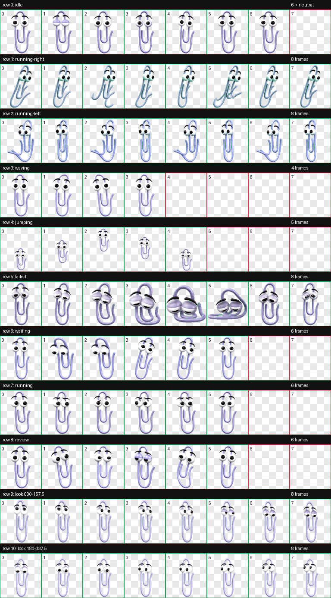
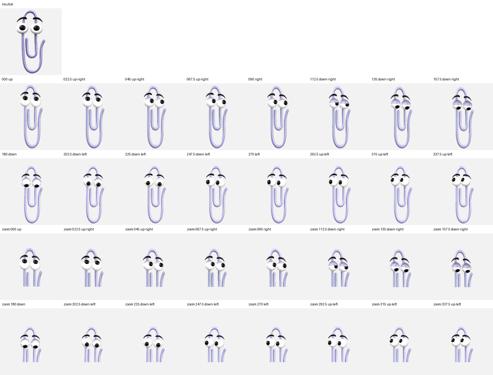

# Clippy for ChatGPT (Codex)

[Türkçe README](README.tr.md)

An unofficial, fan-made animated Clippy pet package for the Codex desktop app. It includes a Codex marketplace plugin, a prompt-driven installer skill, direct macOS/Linux and Windows installers, and the validated v2 pet assets.

> This installs a **Codex desktop pet**. It does not add Clippy to the regular ChatGPT web interface.



## What is included

- 8×11 Codex v2 atlas (`1536×2288`, transparent WebP)
- 9 standard animation states
- 16 clockwise look directions
- `spriteVersionNumber: 2` pet manifest
- SHA-256 verified installers
- Codex plugin marketplace metadata and an install skill

No external connector plugin, API key, or account integration is required. This repository **is** the plugin marketplace.

## Install through Codex plugins

```bash
codex plugin marketplace add eymndev/clippy-for-chatgpt
codex plugin add clippy-for-chatgpt@clippy-for-chatgpt
```

Start a new Codex task, then paste:

```text
Use $install-clippy-pet to install the bundled Clippy pet into Codex and verify it. If a different Clippy pet would be overwritten, ask me first.
```

If the pet is not visible immediately, relaunch the Codex desktop app.

## Direct install

macOS/Linux:

```bash
git clone https://github.com/eymndev/clippy-for-chatgpt.git
cd clippy-for-chatgpt
./install.sh
```

Windows PowerShell:

```powershell
git clone https://github.com/eymndev/clippy-for-chatgpt.git
Set-Location clippy-for-chatgpt
./install.ps1
```

The installer writes only to `${CODEX_HOME:-$HOME/.codex}/pets/clippy`. A non-identical existing package is never replaced unless `--force` (or `-Force`) is explicitly supplied.

## Update

```bash
codex plugin marketplace upgrade clippy-for-chatgpt
codex plugin add clippy-for-chatgpt@clippy-for-chatgpt
```

Start a new Codex task and run the same installation prompt.

## Uninstall

```bash
./uninstall.sh --yes
```

Windows:

```powershell
./uninstall.ps1 -Yes
```

## Verification

```bash
python3 scripts/validate_repo.py
```

The repository validator checks plugin/marketplace structure, manifest values, hashes, and the WebP dimensions.

## Direction QA



## License and trademark notice

Installer code and original documentation are MIT licensed. Clippy is a Microsoft character; the character, name, reference imagery, and generated derivative sprite artwork are excluded from the MIT grant. This project is unofficial and is not affiliated with or endorsed by Microsoft, OpenAI, or ChatGPT. See [THIRD_PARTY_NOTICES.md](THIRD_PARTY_NOTICES.md).
