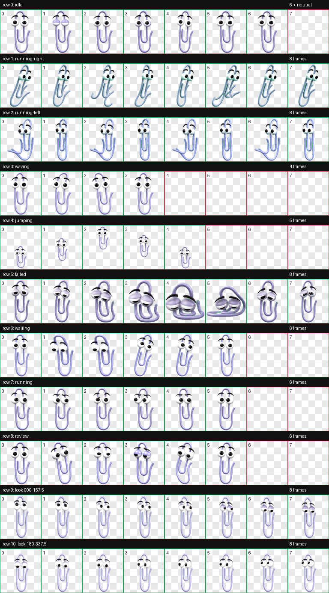

# ChatGPT için Clippy (Codex)

[English README](README.md)

<p align="center">
  
</p>

Codex masaüstü uygulaması için hazırlanmış, resmî olmayan ve hayran yapımı animasyonlu Clippy pet paketidir. Codex marketplace plugin’i, prompt ile çalışan kurulum becerisi, macOS/Linux ve Windows kurucuları ve doğrulanmış v2 pet dosyalarını içerir.

> Bu paket **Codex masaüstü peti** kurar. Normal ChatGPT web arayüzüne Clippy eklemez.



## İçerik

- 8×11 Codex v2 atlası (`1536×2288`, saydam WebP)
- 9 standart animasyon durumu
- Saat yönünde 16 bakış yönü
- `spriteVersionNumber: 2` pet manifesti
- SHA-256 doğrulamalı kurucular
- Codex marketplace manifesti ve kurulum becerisi

Haricî connector plugin, API anahtarı veya hesap bağlantısı gerekmez.

## Codex uygulamasında tek promptla kurulum (komut satırı yok)

Yeni bir Codex görevi açıp aşağıdaki promptu aynen yapıştır. Kullanıcı terminal açmaz veya komut yazmaz; indirme, doğrulama ve yerel kurulum işlemlerini Codex kendi araçlarıyla yapar. Yalnızca ağ ve pet klasörüne yazma için Codex'in standart izin pencerelerini onaylaman gerekebilir.

```text
Codex masaüstü uygulamasına Clippy petini kur. İşlemin tamamını kendi yerel dosya ve terminal araçlarınla yap; benden Terminal uygulamasını açmamı veya herhangi bir komutu elle çalıştırmamı isteme.

Kaynak, GitHub'daki sabit v1.0.1 sürümüdür. Yalnızca şu iki dosyayı indir:

1. pet.json
https://raw.githubusercontent.com/eymnyld/clippy-for-chatgpt/v1.0.1/plugins/clippy-for-chatgpt/assets/pet/clippy/pet.json

2. spritesheet.webp
https://raw.githubusercontent.com/eymnyld/clippy-for-chatgpt/v1.0.1/plugins/clippy-for-chatgpt/assets/pet/clippy/spritesheet.webp

Beklenen SHA-256 değerleri:
- pet.json: e18f38295dba206ba9cb69afdd462d472c8e0787ad38dc302bf02c2371c4b88a
- spritesheet.webp: 96b04a0a1a82060e663a3b17c914630d47f66b6f80dad425a6c0f5c67c642ea5

Dosyaları önce yeni bir geçici klasöre indir. Ağ veya dosya sistemi izni gerekirse normal Codex izin isteğini göster ve izin verildikten sonra devam et. Her iki SHA-256 değeri birebir eşleşmezse hiçbir şeyi kurma veya değiştirme; hatayı bildir. pet.json dosyasını ayrıştırıp id değerinin "clippy", spriteVersionNumber değerinin 2 ve spritesheetPath değerinin "spritesheet.webp" olduğunu doğrula.

Kurulum hedefi, CODEX_HOME tanımlıysa onun altındaki pets/clippy klasörü; tanımlı değilse macOS/Linux için $HOME/.codex/pets/clippy, Windows için kullanıcı profilindeki .codex\pets\clippy klasörüdür. Hedefte aynı hashli iki dosya zaten varsa değişiklik yapma ve kurulumun hazır olduğunu bildir. Farklı pet.json veya spritesheet.webp varsa yalnızca bu mevcut iki dosyayı pets klasörü altında zaman damgalı clippy-backup-* klasörüne kopyala; başka petleri, beklenmeyen dosyaları veya Codex ayarlarını silme/değiştirme. Bu prompt, söz konusu iki Clippy dosyasını yedekleyip doğrulanmış sürümle değiştirmene açıkça izin verir.

Doğrulanmış dosyaları hedefe kur, kurulum sonrasında iki dosyanın SHA-256 değerlerini tekrar kontrol et ve tam hedef yolu, yedek oluşturulup oluşturulmadığını ve doğrulama sonucunu bildir. Son olarak pet görünmüyorsa Codex masaüstü uygulamasını yeniden başlatmam gerektiğini söyle.
```

Aynı prompt ayrı dosya olarak da bulunur: [INSTALL-PROMPT-TR.txt](INSTALL-PROMPT-TR.txt). İngilizce sürüm: [INSTALL-PROMPT-EN.txt](INSTALL-PROMPT-EN.txt).

## Alternatif: Codex plugin olarak kurulum

```bash
codex plugin marketplace add eymnyld/clippy-for-chatgpt
codex plugin add clippy-for-chatgpt@clippy-for-chatgpt
```

Yeni bir Codex görevi aç ve şu promptu yapıştır:

```text
Use $install-clippy-pet to install the bundled Clippy pet into Codex and verify it. If a different Clippy pet would be overwritten, ask me first.
```

Pet hemen görünmezse Codex masaüstü uygulamasını yeniden başlat.

## Doğrudan kurulum

macOS/Linux:

```bash
git clone https://github.com/eymnyld/clippy-for-chatgpt.git
cd clippy-for-chatgpt
./install.sh
```

Windows PowerShell:

```powershell
git clone https://github.com/eymnyld/clippy-for-chatgpt.git
Set-Location clippy-for-chatgpt
./install.ps1
```

Kurucu yalnızca `${CODEX_HOME:-$HOME/.codex}/pets/clippy` klasörüne yazar. Farklı bir Clippy paketi `--force` veya `-Force` açıkça verilmeden değiştirilmez.

## Güncelleme

```bash
codex plugin marketplace upgrade clippy-for-chatgpt
codex plugin add clippy-for-chatgpt@clippy-for-chatgpt
```

Yeni bir Codex görevi açıp kurulum promptunu tekrar çalıştır.

## Kaldırma

```bash
./uninstall.sh --yes
```

Windows:

```powershell
./uninstall.ps1 -Yes
```

## Doğrulama

```bash
python3 scripts/validate_repo.py
```

Kod ve özgün dokümantasyon MIT lisanslıdır. Clippy karakteri, adı, referans görselleri ve türetilmiş sprite çizimi MIT kapsamına dahil değildir. Proje Microsoft, OpenAI veya ChatGPT ile bağlantılı ya da onlar tarafından onaylanmış değildir. Ayrıntılar: [THIRD_PARTY_NOTICES.md](THIRD_PARTY_NOTICES.md).
